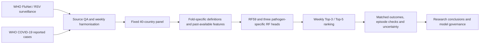

[README.md](https://github.com/user-attachments/files/34295640/README.md)
# Humanitarian Health Intelligence

**Retrospective respiratory-surveillance early warning | Country-level, weekly analyst prioritisation**

A data science research project examining whether public respiratory surveillance can help prioritise countries for review ahead of elevated influenza, respiratory syncytial virus (RSV) or COVID-19 activity.

> **Research status — 2 November 2026:** Retrospective model-comparison and reproducibility study. **Not a deployed outbreak-alert system.** The existing **RF59-D2 registered model remains a shadow reference**; the later **THREE_HEAD** has been **selected as the final research model**, but has **not** been formally promoted or registered for deployment.

## At a glance

| Dimension | Scope |
|---|---|
| Decision problem | Which eligible countries should an analyst review each week for potential elevated respiratory surveillance activity? |
| Prediction unit | Country × forecast week |
| Assessment window | Four weekly observations (approximately 28 days) |
| Surveillance streams | Influenza, RSV and COVID-19 |
| Modelling population | 40 fixed countries in the corrected study; not a worldwide population estimate |
| Operational constraint | Top-3 and Top-5 country reviews per forecast week |
| Main corrected comparison | Single Random Forest (RF59) vs three pathogen-specific Random Forest heads (THREE_HEAD) |
| Evaluation status | Seven **retrospective development** periods, `2023_H1`–`2026_H1`; no untouched independent test in this comparison |
| Stack | Python, pandas, NumPy, scikit-learn, PySpark, Databricks / Unity Catalog, MLflow |

## Executive summary

The research began with an exploratory cholera use case, then shifted to respiratory surveillance when the original data did not support the intended weekly prediction task with adequate consistency. The final research question concerns **surveillance-defined activity elevation**, **not** an official disease outbreak, individual infection risk or composite humanitarian-vulnerability score.

Using matched saved predictions over **2,491 eligible country-weeks across 183 forecast weeks**, the three-head disease-aware approach achieved a **seven-period mean ROC-AUC of 0.7187**, compared with **0.6917** for the corrected RF59 comparator (paired mean difference **+0.0270**). THREE_HEAD also produced **372 versus 342 known-positive Top-5 reviews** at the same 915-review budget. For confirmed country–pathogen onset events with a forecasting opportunity, it detected **91/120 versus 73/120** at Top-5.

These findings are **encouraging but not deployment evidence**: the seven periods were already used in development, publication-time source vintages were not fully reconstructable, the average-precision improvement is uncertain, and the matched random-selection expectation for Top-5 onset detection was **88.37 events**—close to the 91 observed for THREE_HEAD. The original formal Gate-4 evaluation found **no challenger met every promotion criterion**; the registered RF59-D2 shadow reference was retained.

## Research question and intended workflow

> Given a weekly snapshot of eligible national respiratory surveillance indicators, which countries warrant a limited analyst review for possible elevated activity in the following four-week assessment window?

The intended output is a **ranked review queue**, not a binary emergency declaration. Country rankings are built using model scores **before** future outcome availability is considered. A human analyst can then combine the queue with reporting completeness, local epidemiology and contextual humanitarian information.



## Data sources and provenance

| Source | Research use | Important qualification |
|---|---|---|
| [WHO FluNet](https://www.who.int/tools/flunet) | Influenza and RSV surveillance, including reported laboratory detections and testing support | Testing intensity, reporting source and completeness vary across countries and weeks. |
| [WHO COVID-19 dashboard data](https://data.who.int/dashboards/covid19/data) | Reported COVID-19 cases transformed for weekly activity features | Case counts are **not** directly comparable to influenza/RSV laboratory positivity; later corrections and changing testing practices affect historical data. |
| Historical country/week and WHO-region context | Calendar effects, within-country dynamics and regional peer features | Regional values and country coverage require time-availability and missingness checks. |

The research uses **publicly reported aggregate surveillance**, not patient-level records. Source snapshots, their lineage and saved derived artifacts are held in the project’s Databricks workspace; the GitHub repository does **not** need to distribute underlying raw files or model binaries.

**Measurement principle:** A missing report is not a zero. Invalid numerator/denominator combinations, gaps, source-type differences and retrospective revisions are treated explicitly. The historical exercise cannot fully establish what each national source had published on every original forecast date.

## Methodology

### 1. Country-week construction and target definition

The **corrected C4 study** uses a fixed set of 40 countries and seven chronological half-year evaluation periods, `2023_H1` through `2026_H1`. This cohort and evaluation protocol **must not be conflated** with the older V1 validation or V2 four-fold queue.

- Country- and pathogen-specific activity thresholds are fitted from earlier information using a **historical 80th percentile** and an eligibility rule requiring approximately **70% reporting coverage**.
- The evaluation queue requires five complete, already available weekly observations for **at least two respiratory streams** and excludes an already-known elevated latest-available activity signal.
- Surveillance predictors follow an **assumed 21-day availability offset** (one completed week plus a 14-day reporting buffer). Training-label maturity is conservatively assumed at **42 days**. Neither assumption substitutes for verified historical publication timestamps.
- An observation is **positive** when an in-scope respiratory stream has an observed threshold exceedance in the four-week assessment window. A **negative** label requires complete required follow-up across the in-scope streams. Otherwise the outcome remains **unknown**, not negative.
- No future outcome labels are used to determine the contemporaneous ranking population.

The assessment window starts at each forecast-origin week and includes that week plus the next three weekly observations. The task is a retrospective approximation of a decision-time surveillance workflow, not prospective outbreak forecasting.

### 2. Feature engineering and modelling

The historical RF59 feature specification comprises **35 original features** (21 local surveillance, 12 regional and 2 seasonal) plus **24 robust dynamic features**. Dynamic features span the three pathogen streams and include threshold distance, past-only historical percentile, four-week slope, acceleration, consecutive increases, rolling maximum/minimum and volatility. Three unstable threshold-ratio candidates were not retained.

The corrected comparisons retain established Random Forest settings rather than running another unrestricted search:

```text
RandomForestClassifier(
    n_estimators=500,
    min_samples_leaf=10,
    max_features="sqrt",
    max_depth=None,
    class_weight=None,
    random_state=42,
)
Median imputation with keep_empty_features=True
```

**RF59 (corrected comparator)** is one Random Forest using the ordered 59-feature panel. **THREE_HEAD** fits separate influenza, RSV and COVID-19 Random Forests using stream-specific inputs and seasonal context; the weekly country score is the **maximum available eligible pathogen-head score**. The scores are **uncalibrated ranking signals**, not interpretable outbreak probabilities.

Other historical experiments include a sharp-rise heuristic, Logistic Regression, histogram gradient boosting, disease-aware candidates, ensembles and alternative score combiners. Their reported metrics belong to their **own** frozen cohorts and protocols; they are not interchangeable with the corrected matched comparison below.

### 3. Evaluation design

- **Chronology:** Models are fitted using earlier eligible observations and subsequently scored against later historical periods. The corrected analysis includes 2026_H1 as **already-consumed development evidence**, not as an untouched holdout.
- **Discrimination:** ROC-AUC and average precision (AP) use observations with **known** future outcomes. Within-week AUC separately assesses cross-country ranking within a forecast week.
- **Operational capacity:** All scoreable countries are ranked each week; Top-3 and Top-5 workloads are fixed **before** outcome filtering. Unknown outcomes stay in the review workload but not in known-outcome precision denominators.
- **Distinct onset events:** A country–pathogen elevation onset requires a qualifying prior four-week surveillance history. Detection and warning lead time are evaluated only when at least one eligible prior forecast opportunity exists.
- **Uncertainty:** A paired, four-week moving-block bootstrap with **2,000 resamples** estimates uncertainty for the matched seven-period mean AUC and AP differences. These intervals remain **post-selection** and retrospective.

## Results — corrected matched retrospective comparison

**Evaluation set:** Seven historical development periods · **183** forecast weeks · **2,491** matched country-weeks · **2,094** known outcomes · **397** unknown outcomes · **672** known positive outcomes.

### Discrimination and fixed-budget country prioritisation

| Measure | Corrected RF59 | THREE_HEAD | THREE_HEAD − RF59 |
|---|---:|---:|---:|
| Seven-period macro-mean ROC-AUC | 0.6917 | **0.7187** | **+0.0270** |
| Top-3 positive reviews / 549 total reviews | 230 | **243** | +13 |
| Top-3 precision among known outcomes | 47.52% | **50.73%** | +3.21 pp |
| Top-5 positive reviews / 915 total reviews | 342 | **372** | **+30** |
| Top-5 precision among known outcomes | 43.18% | **47.03%** | +3.85 pp |

Known-outcome review denominators differ slightly because country selections differ: **Top-3 RF59 484 / THREE_HEAD 479**, and **Top-5 RF59 792 / THREE_HEAD 791**. Each method still uses the identical total weekly review budget.

THREE_HEAD had a higher ROC-AUC in **4 of 7** periods. It did **not** improve every fold: in `2026_H1` the corrected RF59 comparator had ROC-AUC **0.7452**, versus **0.7229** for THREE_HEAD.

| Paired historical difference | Estimate | 95% moving-block bootstrap interval |
|---|---:|---:|
| Mean ROC-AUC | **+0.0270** | **+0.0004 to +0.0536** |
| Mean average precision | +0.0139 | −0.0109 to +0.0419 |

The AUC interval narrowly excludes zero; the AP interval includes zero. Because the model strategies were developed and compared on previously inspected historical periods, **neither interval should be interpreted as independent prospective confirmation**.

### Disease-onset detection and early warning

The corrected episode analysis identified **175 confirmed country–pathogen onsets**, of which **120 had an eligible forecasting opportunity**. Another **54 high-activity rows** lacked sufficient four-week preceding history for onset confirmation; these rows are not equivalent to 54 additional distinct events.

| Measure, Top-5 weekly review budget | Corrected RF59 | THREE_HEAD |
|---|---:|---:|
| Detected onsets / 120 eligible | 73 (60.83%) | **91 (75.83%)** |
| Detected at least 1 week before onset | 64 | **75** |
| Detected at least 2 weeks before onset | 49 | 49 |
| Detected at least 3 weeks before onset | **37** | 35 |

**Essential benchmark:** Matched random weekly selection had an expected **88.37 Top-5 onset detections** under this opportunity structure. THREE_HEAD's 91 detections are only modestly higher; an operational advantage over random selection **has not been established robustly** by this result. Country-week review precision and onset-level detection answer different questions and must be presented separately.

The winning head among THREE_HEAD's 549 Top-3 review positions was influenza in **292**, RSV in **225**, and COVID-19 in **32**. This describes **score dominance**, **not** the pathogen responsible for a future event.

## Model governance and research history

| Stage | Historical outcome | Interpretation |
|---|---|---|
| Exploratory data analysis | Cholera feasibility examined; respiratory surveillance selected for the weekly task | Research-question pivot, not a cholera prediction model |
| Version 1 baseline | Fixed cohort, sharp-rise heuristic and Logistic Regression evaluation | Earlier baseline; different split/denominator |
| Version 2 enrichment | Past-only dynamic features, regional reporting-delay sensitivity and four historical development folds | Historical RF59 evidence; **1,612** queue country-weeks and **129** older episodes are *not* C4 denominators |
| Version 3 formal Gate-4 | **No challenger satisfied all frozen promotion gates** | `GATE4_CLOSED_NO_PROMOTION`; registered shadow reference retained |
| Corrected temporal study (C4) | Matched RF59 vs THREE_HEAD and policy sensitivity analyses across seven development periods | Stronger retrospective THREE_HEAD research result; **no production promotion** |

**Registered shadow reference:** `models:/humanitarian.model_ready.respiratory_early_warning_rf59_d2/1` (available only to users with appropriate Databricks/MLflow access). This registered **RF59-D2** artifact must **not** be described as the later corrected RF59 comparator or as a registered THREE_HEAD model. Its inference contract is `FROZEN_SHADOW_PENDING_PROSPECTIVE_VALIDATION`.

The research did not register THREE_HEAD, replace the RF59-D2 shadow reference or satisfy a new promotion gate. Any future approval requires a separate, prospectively specified evaluation with reliable source-publication timestamps and monitoring controls.

## Repository layout and reproducibility

The presentation repository is organised as follows. The five numbered notebooks are cleaned, verification-oriented exports; the full experimental history remains in Databricks.

```text
humanitarian-health-intelligence/
├── README.md
├── .gitignore
└── notebooks/
    ├── README.md
    ├── 01_exploratory_data_analysis_clean.py
    ├── 02_machine_learning_baselines_clean.py
    ├── 03_data_enrichment_final.py
    ├── 04_model_selection_final.py
    └── 05_corrected_temporal_modelling_final.py
```

### Notebook navigation

The numbered notebooks are presentation-ready Databricks source exports. The original historical research notebooks remain in Databricks as a separate audit trail. See also the [notebook index](notebooks/README.md).

| Notebook | Contents | Source |
|---|---|---|
| 01 — Exploratory Data Analysis | Source suitability, initial cholera feasibility, surveillance QA and research pivot | [Open notebook 01](notebooks/01_exploratory_data_analysis_clean.py) |
| 02 — Machine Learning Baselines | Frozen V1 cohort, heuristic and Logistic Regression benchmark | [Open notebook 02](notebooks/02_machine_learning_baselines_clean.py) |
| 03 — Data Enrichment | Past-only features, missingness, temporal folds and historical operational evidence | [Open notebook 03](notebooks/03_data_enrichment_final.py) |
| 04 — Model Selection | Frozen comparison matrix, historical V3 Gate-4 decision and RF59-D2 shadow reference | [Open notebook 04](notebooks/04_model_selection_final.py) |
| 05 — Corrected Temporal Modelling | Seven-period matched RF59–THREE_HEAD comparison, Top-K, episodes and uncertainty | [Open notebook 05](notebooks/05_corrected_temporal_modelling_final.py) |

**Final research selection:** THREE_HEAD is the preferred model for this retrospective research study, selected for stronger mean discrimination and fixed-budget country ranking. **No production promotion:** the older RF59-D2 shadow model remains separately registered; the corrected comparison is not independent prospective validation.

**Reading order:** `01` explains source feasibility and the research pivot; `02` reproduces the original baseline; `03` verifies accepted feature-enrichment evidence; `04` audits the frozen experiment and non-promotion history; `05` reproduces the corrected matched temporal comparison and its uncertainty.

**Execution requirements:** A Databricks workspace with access to the original pinned project datasets and saved Delta artifacts in `humanitarian.model_ready`, plus a Python runtime supporting pandas, NumPy, scikit-learn and PySpark. Relevant model/provenance evidence is retained in MLflow/Unity Catalog; public GitHub access alone **does not provide** those restricted artifacts.

1. Import the numbered notebook files into Databricks, preserving their Markdown and Python cell boundaries.
2. Execute the clean notebooks in order, checking each `PASS` assertion and the saved artifact identities. Notebook `02` refits **only its historical Logistic Regression baseline in memory**; notebooks `01` and `03`–`05` are read-only validation and exploratory documentation using saved results and sources.
3. **Do not** run archived training, registry, freeze, write or one-time holdout cells merely to reproduce documentation. Preserve the original notebooks as an audit trail rather than replacing them.
4. If a required table, historical Delta version, outcome denominator or schema is unavailable or differs, **stop and document the discrepancy**. Do not manufacture missing values or adjust frozen metrics to force a pass.

**Reproducibility boundary:** The five cleaned notebooks have been checked interactively against the project's existing saved Databricks research artifacts. This is **internal artifact-based reproduction**, not a raw-data-to-model public benchmark that an external reader can reproduce with `git clone` alone. Full independent reproduction would additionally require authorised fixed source snapshots, release-time data provenance, a shareable evaluation panel and pinned execution-environment details.

## Limitations and responsible use

- **Retrospective publication timing:** Forecast-time availability was approximated using a 21-day lag; historical reporting/revision vintages were not comprehensively preserved. Point-in-time correctness remains uncertain.
- **Development reuse:** All seven corrected periods, including `2026_H1`, were consumed during retrospective research. This is not an independent holdout or prospective validation.
- **Reporting bias:** Absence of surveillance differs from no infections. Coverage and sampling practices differ among countries and pathogens, particularly RSV.
- **Non-comparable signals:** Influenza/RSV positivity and COVID-19 reported case counts have different ascertainment and denominators; pathogen-head scores are not inherently calibrated against each other.
- **Limited representativeness:** The 40-country modelling cohort was selected retrospectively. Results should not be extrapolated to all countries or subnational locations without further testing.
- **Event definition:** An onset is an algorithmic threshold crossing with an observation-history requirement, **not** a confirmed outbreak or a humanitarian consequence.
- **Operational uncertainty:** Although Top-5 matched-review results favour THREE_HEAD over RF59, the matched random-selection episode benchmark is close to THREE_HEAD's result. Longer-lead early detection is not consistently better.
- **Model lifecycle:** Neither independent prospective performance, alert calibration, fairness across surveillance-coverage strata nor safe deployment monitoring has been established.

**Appropriate use:** Research, audit, model-development discussion and decision-support prototyping with human epidemiological oversight. **Not appropriate for:** clinical decisions, automatic outbreak declarations, resource deployment without local verification, or representations of individual patient risk.

## Source attribution and publication considerations

- [WHO Global Influenza Programme — FluNet](https://www.who.int/tools/flunet)
- [WHO RespiMart / respiratory-virus surveillance context](https://www.who.int/tools/RespiMart)
- [WHO COVID-19 data and interpretation notes](https://data.who.int/dashboards/covid19/data)

WHO data retain the source provider's usage and attribution requirements. This research is **not endorsed by WHO**. No patient-level data or secret keys are required for the public repository. Before publishing additional artifacts, verify organisational permission, remove private workspace identifiers/credentials if necessary, and check that each file is appropriate for a public repository. **No open-source licence is implied** unless a `LICENSE` file is deliberately added.

---

*Research snapshot and verification status: 2 November 2026. Numerical results refer to the named historical experiment and saved-artifact comparison, not live public-health forecasts.*
