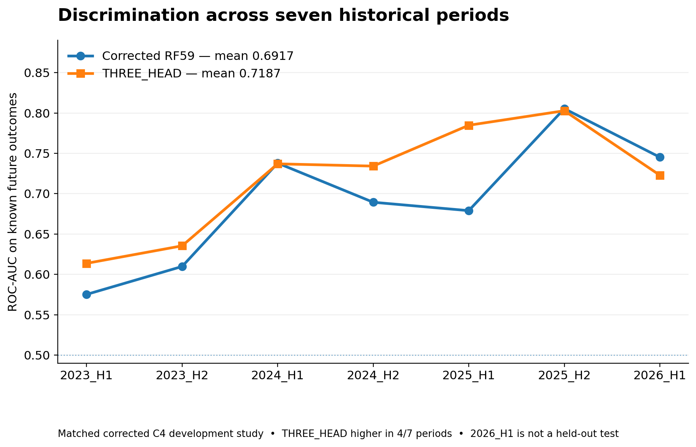
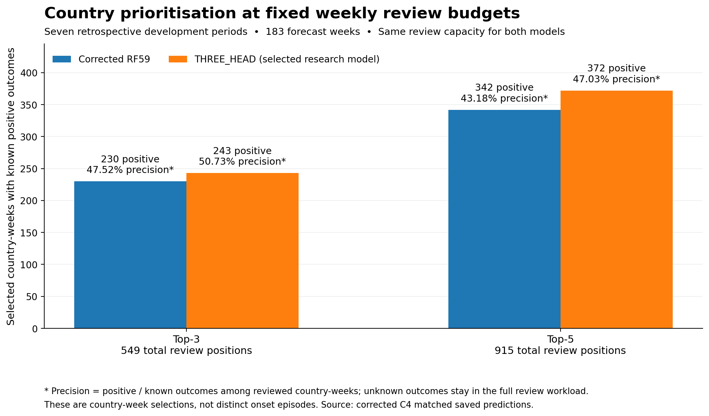
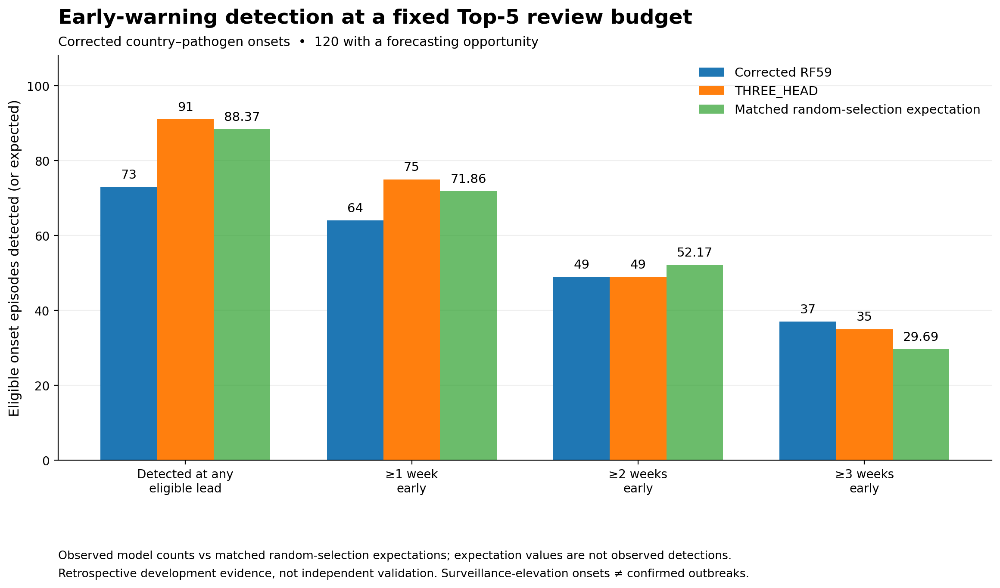
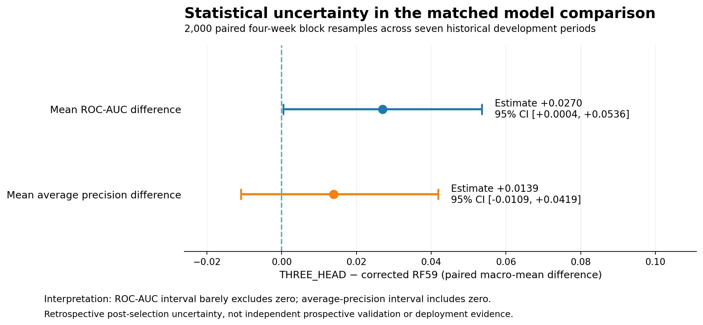
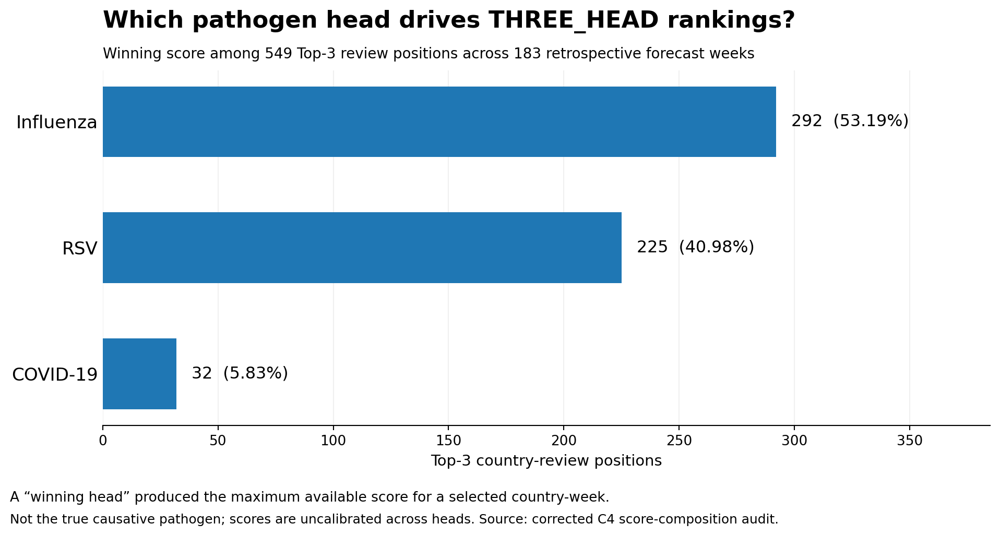

# Evaluation Figures

**Humanitarian Health Intelligence**  
*Corrected retrospective model evaluation | 2 November 2026*

This gallery presents five verified visualisations comparing the corrected RF59 Random Forest with THREE_HEAD, the selected final research model.

All results are retrospective development evidence, not independently validated operational forecasts.

---

## 1. Model Discrimination Across Historical Periods

**Finding:** THREE_HEAD achieved mean ROC-AUC of **0.7187**, compared with **0.6917** for RF59, a paired improvement of **+0.0270**.

THREE_HEAD performed better in four of seven historical periods, although performance varied across periods.

## 2. Top-3 and Top-5 Country Prioritisation

**Finding:** At the same weekly analyst-review capacity, THREE_HEAD identified **243 versus 230** known-positive country-weeks at Top-3 and **372 versus 342** at Top-5.

Top-5 precision among known outcomes was **47.03%** for THREE_HEAD, compared with **43.18%** for RF59.

Unknown outcomes remained in the review workload and were not counted as negatives.

## 3. Disease-Onset Detection and Warning Lead Time

**Finding:** Among 120 eligible country-pathogen onset episodes, THREE_HEAD detected **91 (75.83%)**, compared with **73 (60.83%)** for RF59.

THREE_HEAD identified more episodes at least one week early but did not consistently improve detection at longer lead times.

The matched random-selection expectation was **88.37** Top-5 detections, close to THREE_HEAD's observed 91. Therefore, a robust operational advantage over random selection has not been established.

These onsets are surveillance-defined events, not confirmed outbreaks.

## 4. Statistical Uncertainty

**Finding:** The paired mean ROC-AUC improvement was **+0.0270**, with a 95% bootstrap interval of **+0.0004 to +0.0536**.

The mean average-precision improvement was **+0.0139**, with an interval of **-0.0109 to +0.0419**.

The AUC interval narrowly excludes zero; the AP interval includes zero.

These estimates are retrospective, post-selection uncertainty assessments rather than independent prospective validation.

## 5. Pathogen-Head Contribution to Rankings

**Finding:** Across 549 Top-3 review positions, the highest ranking score came from:

- Influenza: **292 (53.19%)**
- RSV: **225 (40.98%)**
- COVID-19: **32 (5.83%)**

The winning head indicates the model generating the highest score, not necessarily the pathogen responsible for future elevated activity.

Differences in surveillance availability and uncalibrated score distributions may affect head dominance.

---

## Interpretation and Model Governance

**Selected final research model:** THREE_HEAD.

The corrected results favour THREE_HEAD on mean discrimination and fixed-budget country-week prioritisation.

However, results remain retrospective, and independent prospective validation has not been established.

THREE_HEAD has not been formally promoted, registered or deployed. The existing RF59-D2 registered shadow reference remains unchanged.

## Supporting Documentation

- [Full Evaluation Report](../README.md)
- [MLflow Experiment Tracking](../MLFLOW_EVIDENCE.md)
- [Corrected Temporal Modelling Notebook](../../notebooks/05_corrected_temporal_modelling_final.py)
- [Main Project README](../../README.md)
